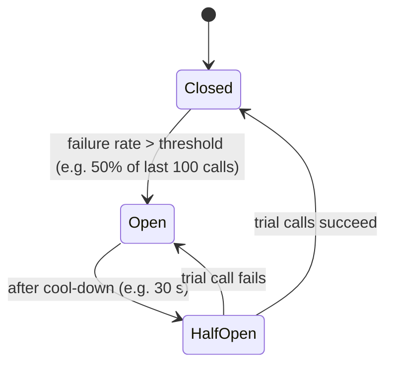
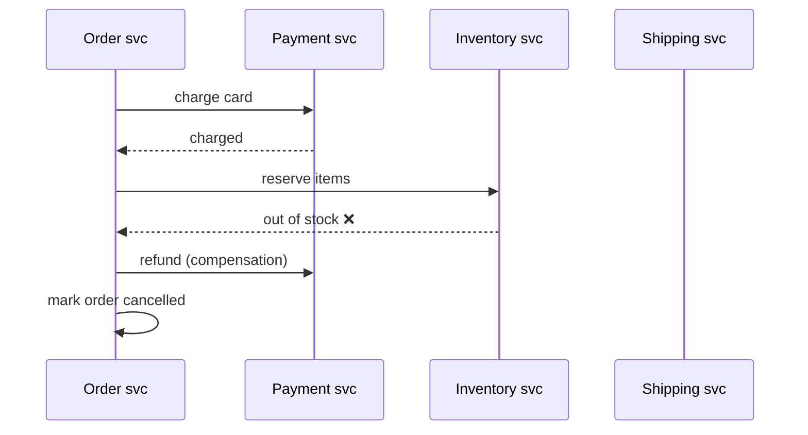
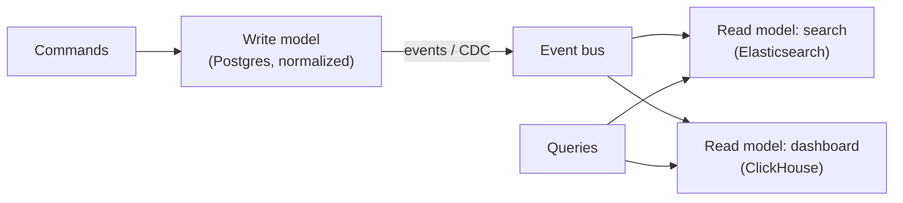

# Distributed Systems Patterns

<Note>
**TL;DR**

In a distributed system every call can be slow, fail, or succeed without you knowing. The standard toolkit: **timeouts** on everything, **retries with exponential backoff and jitter** (only for idempotent operations), **idempotency keys**, **circuit breakers** to stop hammering a sick dependency, **bulkheads** to isolate failures, **backpressure / load shedding** to stay alive under overload, **sagas** instead of distributed transactions, the **outbox** pattern for reliable events, and **CQRS** to split write and read models.
</Note>

## The fallacies to design against
The network is not reliable, latency is not zero, bandwidth is not infinite, the network is not secure, topology changes, there are many administrators, transport cost is not zero, the network is not homogeneous (Deutsch & Gosling).

A remote call has **three** outcomes: success, failure, and **unknown** (timed out after the server may have done the work). Most patterns below exist because of "unknown".

## Timeouts
- Every network call needs a timeout; library defaults are often infinite or 30+ s.
- Set from the dependency's p99.9 latency plus margin, and respect the **caller's deadline**: propagate a deadline (gRPC deadlines, `X-Request-Deadline`) so downstream stops work nobody is waiting for.
- Connect timeout (short) ≠ request timeout.

## Retries with exponential backoff and jitter
```python
import random, time
def call_with_retry(fn, max_attempts=5, base=0.1, cap=5.0):
    for attempt in range(max_attempts):
        try:
            return fn()
        except TransientError:
            if attempt == max_attempts - 1: raise
            sleep = random.uniform(0, min(cap, base * 2 ** attempt))  # "full jitter"
            time.sleep(sleep)
```
- **Only retry idempotent operations** (or make them idempotent with a key).
- Retry only **transient** errors (timeouts, 503, 429 with `Retry-After`), not 400/401/404.
- **Jitter** spreads retries so clients don't synchronize into waves.
- **Retry budgets**: cap retries to e.g. 10% of requests; retry at **one layer** only. Retries at 3 layers × 3 attempts = 27× amplification: a **retry storm**.

## Idempotency
An operation is idempotent if doing it twice has the same effect as once. `PUT`, `DELETE` are idempotent by design; `POST /payments` is not.

```http
POST /v1/payments
Idempotency-Key: 3f7a9c2e-...        # client-generated, reused on retry
```
Server side:
1. Look up the key. If a completed result is stored, return it.
2. If in progress, return 409 (or wait).
3. Else insert the key (unique constraint) with status `processing`, do the work, store the response, in the same transaction as the side effect where possible.
4. Expire keys after e.g. 24 h.

Also: conditional writes (`UPDATE ... WHERE version = 7`), upserts, dedupe tables for message consumers ([Message Queues & Event Streaming](/Software%20Engineering/System%20Design/Message%20Queues%20%26%20Event%20Streaming)).

## Circuit breaker
Stop calling a dependency that is failing, fail fast, and probe for recovery.

- While open: return a **fallback** (cached value, default, degraded feature) or an error immediately.
- Libraries: Resilience4j (Java), Polly (.NET), `opossum` (Node), Envoy/Istio outlier detection at the mesh level.

## Bulkhead
Partition resources so one failing dependency can't sink everything (named after ship compartments).
- Separate thread pools / connection pools / semaphores per dependency.
- Separate clusters or **cells** per tenant tier.
- Example: the "recommendations" pool is exhausted by a slow service, but checkout has its own pool and keeps working.

## Backpressure and load shedding
- **Backpressure**: a slow consumer signals the producer to slow down (bounded queues, TCP flow control, reactive streams `request(n)`, Kafka consumer pausing).
- **Unbounded queues** turn overload into out-of-memory and unbounded latency.
- **Load shedding**: when saturated, reject early (429/503) the cheapest-to-reject and lowest-priority requests. Prefer **LIFO/adaptive** queueing under overload so fresh requests succeed instead of everyone timing out.
- **Rate limiting** protects from abusive clients ([Rate Limiting & Throttling](/Software%20Engineering/APIs%20%26%20Auth/Rate%20Limiting%20%26%20Throttling), [Case Study - Rate Limiter](/Software%20Engineering/System%20Design/Case%20Studies/Case%20Study%20-%20Rate%20Limiter)).

## Sagas (distributed transactions without 2PC)
A saga is a sequence of local transactions; each step has a **compensating** action that semantically undoes it. See [Replication & 2PC 3PC](/Software%20Engineering/Databases/Database%20Round/Replication%20%26%202PC%203PC) for why 2PC is avoided across services.


| | Choreography | Orchestration |
|---|---|---|
| How | Services react to each other's events | A central orchestrator issues commands |
| Pros | Loose coupling, no central component | Explicit flow, easier to reason, monitor, change |
| Cons | Hard to follow; cyclic dependencies | Orchestrator is a component to own |
| Tools | Kafka events | Temporal, AWS Step Functions, Camunda |

Sagas give **no isolation**: other transactions can see intermediate states. Use semantic locks (`status = PENDING`), commutative updates, and design compensations to be idempotent.

## Transactional outbox (and inbox)
Write the state change and the event in one local transaction; a relay publishes. Detailed in [Message Queues & Event Streaming](/Software%20Engineering/System%20Design/Message%20Queues%20%26%20Event%20Streaming#the-outbox-pattern).

## CQRS
**Command Query Responsibility Segregation**: separate the write model (validates commands, enforces invariants) from one or more read models (denormalized for queries), synced via events.

- ✅ Scale reads and writes independently; query-optimized views.
- ❌ Eventual consistency between models; more moving parts. Don't use it for simple CRUD.
- Often paired with **event sourcing** (state = fold over an event log), but they're independent ideas.

## Other patterns worth knowing
| Pattern | One-liner |
|---|---|
| **Hedged requests** | Send a duplicate to another replica if the first hasn't answered by p95; take the first reply (cuts tail latency) |
| **Leader election / lease** | One instance does the singleton work ([Consistency Models & Consensus](/Software%20Engineering/System%20Design/Consistency%20Models%20%26%20Consensus)) |
| **Sidecar / service mesh** | Retries, mTLS, metrics in a proxy next to each service |
| **Strangler fig** | Incrementally replace a legacy system behind a facade |
| **Cell-based architecture** | Independent full-stack copies each serving a shard of users; limits blast radius |
| **Health endpoint + graceful shutdown** | Drain connections before exit |
| **Static stability** | Keep working with last known good config when the control plane is down |

## Senior perspective
- The combination matters: timeouts < caller deadline, retries with budget and jitter, breaker around it, bulkhead per dependency.
- Retries + no idempotency = duplicate charges. Retries + no backoff = self-inflicted DDoS during recovery.
- **Metastable failures**: a system stays overloaded after the trigger is gone because retries/cold caches keep load above capacity. Recovery needs load shedding or cutting traffic.
- Configuration is code: roll out config and feature files progressively with validation and automatic rollback.
- In review ask: "What happens if this call hangs for 60 s? Is this handler safe to run twice? Where's the compensating action?"

<Info>
**🆕 2025–2026: incident lessons**

- **AWS us-east-1, 2025-10-19/20**: two instances of DynamoDB's DNS "Enactor" automation raced; a stale plan overwrote a newer one and cleanup then deleted it, leaving an empty DNS record for the regional endpoint. Recovery of dependent systems (EC2 launches, NLB health checks) took many more hours. Patterns implicated: guard automation against concurrent/stale execution (fencing, versions), static stability, and dependency awareness. ([AWS summary](https://aws.amazon.com/message/101925/))
- **Cloudflare, 2025-11-18**: an internally generated feature file doubled in size and exceeded a hard limit in the proxy, which failed rather than falling back to the last good file. **Cloudflare, 2025-12-05**: a global config change propagated instantly. Their follow-up "Code Orange: Fail Small" plan commits to staged, health-mediated rollouts for config and to failing open with last-known-good data. ([Nov 18](https://blog.cloudflare.com/18-november-2025-outage/), [Fail Small](https://blog.cloudflare.com/fail-small-resilience-plan/))
</Info>

## Interview questions
<Accordion title="Why add jitter to exponential backoff?">
Without jitter, clients that failed at the same time retry at the same times, producing synchronized load spikes. Randomizing the delay spreads retries out and lets the dependency recover.
</Accordion>

<Accordion title="How do you make a payment API safe to retry?">
Require an idempotency key per logical operation; store key + request hash + result with a unique constraint, in the same transaction as the charge where possible; replay the stored result on duplicates; return 409 for in-progress or mismatched payloads.
</Accordion>

<Accordion title="Circuit breaker vs retry?">
Retries handle brief transient failures of single calls. A circuit breaker handles sustained failure: it stops calls entirely for a while to fail fast, save resources and let the dependency recover. They're used together; the breaker wraps the retrying call.
</Accordion>

<Accordion title="Saga vs 2PC?">
2PC gives atomicity by locking resources across participants and blocking if the coordinator fails; it couples services and hurts availability. A saga runs local transactions with compensations: available and loosely coupled, but only eventually consistent and without isolation.
</Accordion>

<Accordion title="What is CQRS and when is it overkill?">
Separating write and read models, syncing via events. Useful when read and write workloads/shapes differ a lot (search, analytics, heavy denormalized views). Overkill for straightforward CRUD, because it adds eventual consistency and infrastructure.
</Accordion>

<Accordion title="What is backpressure?">
A mechanism for a slower consumer to limit how fast a producer sends, via bounded buffers, flow control or demand signaling, so overload leads to slowing or rejecting work rather than unbounded queues and crashes.
</Accordion>

## Related
- [System Design Index](/Software%20Engineering/System%20Design/System%20Design%20Index)
- [Message Queues & Event Streaming](/Software%20Engineering/System%20Design/Message%20Queues%20%26%20Event%20Streaming) · [Consistency Models & Consensus](/Software%20Engineering/System%20Design/Consistency%20Models%20%26%20Consensus) · [Microservices Architecture](/Software%20Engineering/DevOps/Microservices%20Architecture) · [Software Architecture Styles](/Software%20Engineering/Principles/Software%20Architecture%20Styles)
- [Rate Limiting & Throttling](/Software%20Engineering/APIs%20%26%20Auth/Rate%20Limiting%20%26%20Throttling) · [API Gateways & Reverse Proxies](/Software%20Engineering/Backend/API%20Gateways%20%26%20Reverse%20Proxies) · [Observability - Logs, Metrics & Traces](/Software%20Engineering/DevOps/Observability%20-%20Logs%2C%20Metrics%20%26%20Traces) · [Replication & 2PC 3PC](/Software%20Engineering/Databases/Database%20Round/Replication%20%26%202PC%203PC)

## Sources
- Michael Nygard, *Release It!* (2nd ed.), stability patterns
- [AWS Builders' Library: Timeouts, retries, and backoff with jitter](https://aws.amazon.com/builders-library/timeouts-retries-and-backoff-with-jitter/)
- [AWS Architecture Blog: Exponential backoff and jitter](https://aws.amazon.com/blogs/architecture/exponential-backoff-and-jitter/)
- [Stripe: Designing robust and predictable APIs with idempotency](https://stripe.com/blog/idempotency)
- [Martin Fowler: CircuitBreaker](https://martinfowler.com/bliki/CircuitBreaker.html) · [CQRS](https://martinfowler.com/bliki/CQRS.html)
- [microservices.io: Saga pattern](https://microservices.io/patterns/data/saga.html)
- [Bronson et al.: Metastable Failures in Distributed Systems (HotOS 2021)](https://sigops.org/s/conferences/hotos/2021/papers/hotos21-s11-bronson.pdf)
- [AWS: DynamoDB disruption summary, Oct 2025](https://aws.amazon.com/message/101925/)
- [Cloudflare: Code Orange: Fail Small](https://blog.cloudflare.com/fail-small-resilience-plan/)
