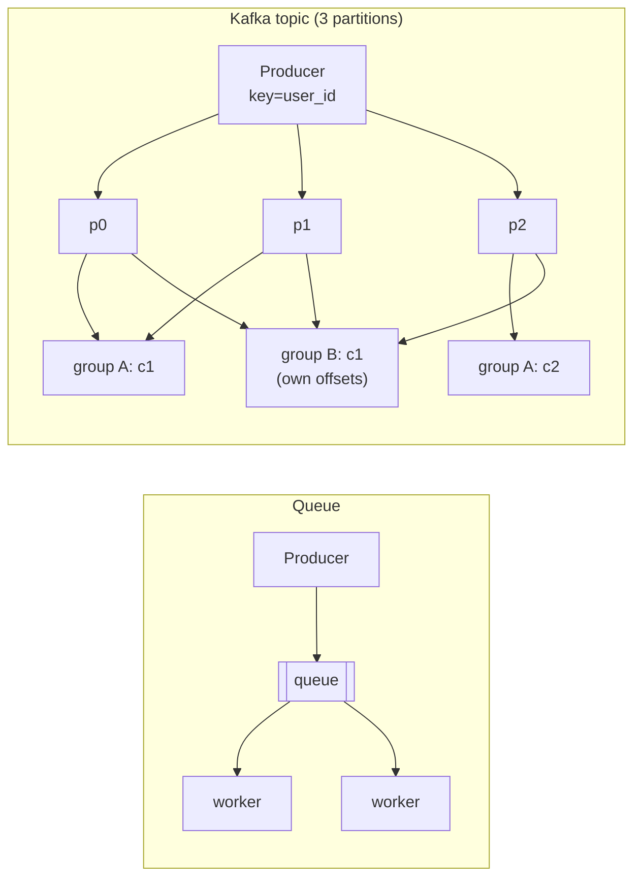

# Message Queues & Event Streaming

<Note>
**TL;DR**

Messaging decouples producers from consumers in time and scale. Three shapes: a **queue** (each message processed by one worker, then deleted: SQS, RabbitMQ), **pub/sub** (each subscriber gets a copy: SNS, Google Pub/Sub), and a **log** (an append-only, replayable, partitioned stream read by consumer groups at their own offsets: Kafka, Kinesis, Redpanda). Delivery is **at-most-once** or **at-least-once** in practice; "exactly-once" means at-least-once delivery plus **idempotent** or transactional processing. Ordering is only per partition/group, failures go to a **DLQ**, and the **outbox pattern** keeps DB writes and events consistent.
</Note>

## Why queues
- **Decoupling**: producer doesn't need the consumer to be up.
- **Load leveling**: absorb spikes; workers drain at their own pace.
- **Async work**: send emails, resize images, charge cards off the request path.
- **Fan-out**: one event, many independent consumers.
- **Replay** (logs): rebuild a read model, backfill a new service.

## Queue vs pub/sub vs log
| | Queue | Pub/sub | Log (stream) |
|---|---|---|---|
| Consumption | Competing consumers; one gets each message | Every subscription gets a copy | Consumer groups; each group reads everything, members split partitions |
| After consumption | Deleted (acked) | Deleted per subscription | Retained by time/size; replayable |
| Ordering | Usually none (FIFO variants exist) | Usually none | Per partition |
| Examples | SQS, RabbitMQ queues, Celery/Sidekiq backends | SNS, GCP Pub/Sub, Redis Pub/Sub | Kafka, Kinesis, Redpanda, Pulsar, Redis Streams |
| Good for | Task/job processing | Notifications to many systems | Event sourcing, CDC, analytics, stream processing |



## Kafka core concepts
- **Topic** split into **partitions**; each partition is an ordered, append-only log; records have **offsets**.
- **Key → partition** (hash of key). Same key → same partition → ordered.
- **Consumer group**: each partition is read by at most one member of the group, so max parallelism = number of partitions.
- **Replication**: each partition has a leader and followers; `acks=all` + `min.insync.replicas=2` for durability.
- **Retention**: by time/size, or **log compaction** (keep the latest value per key; good for changelogs).
- **Rebalance**: when members join/leave, partitions are reassigned.

```java
// Idempotent producer, durable writes
props.put("acks", "all");
props.put("enable.idempotence", "true");       // no duplicates from producer retries
props.put("key.serializer", StringSerializer.class);
producer.send(new ProducerRecord<>("orders", order.userId(), json));

// Consumer: at-least-once (commit AFTER processing)
consumer.subscribe(List.of("orders"));
while (true) {
  for (var rec : consumer.poll(Duration.ofMillis(500))) process(rec);  // must be idempotent
  consumer.commitSync();
}
```

## RabbitMQ and SQS in one breath
- **RabbitMQ**: smart broker. Producers publish to **exchanges** (direct, topic, fanout, headers) that route to **queues** via bindings. Per-message ack, priorities, TTL, DLX. Quorum queues (Raft) for durability; streams for log-style use.
- **Amazon SQS**: fully managed queue. Standard (at-least-once, best-effort order, near-unlimited throughput) or FIFO (ordered per **message group**, exactly-once processing within a 5-minute dedup window). **Visibility timeout** hides a received message until deleted or timed out. Pair with SNS for fan-out.

## Delivery semantics
| Semantics | How it happens | Risk |
|---|---|---|
| **At-most-once** | Ack/commit **before** processing | Lost messages on crash |
| **At-least-once** | Ack/commit **after** processing | Duplicates on crash/retry |
| **Exactly-once (effectively)** | At-least-once + idempotent consumer, or transactions (Kafka EOS: read-process-write within Kafka) | Only holds inside the boundary |

<Tip>
**Design rule**

Assume **at-least-once** and make consumers **idempotent**: dedupe on a message/event ID stored in the same DB transaction as the side effect, or use natural idempotency (upsert, `SET status='paid' WHERE status='pending'`). See [Distributed Systems Patterns](/Software%20Engineering/System%20Design/Distributed%20Systems%20Patterns).
</Tip>

```sql
-- Idempotent consumer: dedupe table in the same transaction
BEGIN;
INSERT INTO processed_messages(message_id) VALUES ($1);  -- PK violation => duplicate, rollback & ack
UPDATE accounts SET balance = balance - $2 WHERE id = $3;
COMMIT;
```

## Ordering
- Global ordering doesn't scale. Get ordering **per entity** by keying on it (user_id, order_id).
- Retries can reorder (a failed message retried after later ones). If order matters, block the partition/group on failure, or use versions/sequence numbers and let consumers drop stale events.
- Increasing partition count changes key→partition mapping; plan partitions up front.

## Failure handling
- **Retries with backoff**; separate retry topics (`orders.retry.1m`, `orders.retry.10m`) so the main topic isn't blocked.
- **Dead-letter queue (DLQ)**: after N attempts, park the message with error metadata; alert; build a redrive tool.
- **Poison messages**: bad payloads that always fail; DLQ them fast rather than retrying forever.
- **Consumer lag** is the key metric: alert on growing lag, autoscale workers on it.
- **Backpressure**: bounded in-flight work, pause consumption when downstream is slow.

## The outbox pattern
Problem: "update DB and publish event" is a dual write; if either fails you're inconsistent.

```mermaid
sequenceDiagram
  participant S as Order service
  participant DB as Database
  participant R as Relay (poller or CDC/Debezium)
  participant K as Kafka
  S->>DB: BEGIN; INSERT order; INSERT outbox(event); COMMIT
  R->>DB: read new outbox rows / WAL
  R->>K: publish event (at-least-once)
  R->>DB: mark sent (or advance CDC offset)
```
Consumers dedupe by event ID. The inverse is the **inbox pattern** (store received message IDs before processing). Details in [Distributed Systems Patterns](/Software%20Engineering/System%20Design/Distributed%20Systems%20Patterns).

## Choosing
| Need | Pick |
|---|---|
| Simple background jobs on AWS | SQS (+ Lambda or workers) |
| Complex routing, priorities, per-message ack, RPC-ish | RabbitMQ |
| High-throughput event streams, replay, CDC, stream processing, many consumers | Kafka (or managed: MSK, Confluent, Redpanda) |
| Small scale, already have Redis/Postgres | Redis Streams, or Postgres-backed queues (`SELECT ... FOR UPDATE SKIP LOCKED`) |

<Info>
**🆕 2025–2026**

- **Kafka 4.0 (2025-03-18)**: ZooKeeper mode **removed**; **KRaft** is the only metadata mode (migrate via 3.9 first). The new consumer rebalance protocol (**KIP-848**) went GA, and **Queues for Kafka (KIP-932, "share groups")** shipped as early access. ([Apache Kafka blog](https://kafka.apache.org/blog/2025/03/18/apache-kafka-4.0.0-release-announcement/))
- **Share groups** went to preview in Kafka 4.1 and are **production-ready in Kafka 4.2 (2026-02-17)**: consumers in a share group cooperatively read the same partitions with **per-record acknowledgement**, redelivery and delivery-count tracking, so the number of consumers is no longer capped by the partition count. Use them for job-queue workloads where per-key order doesn't matter. ([Kafka 4.2 announcement](https://kafka.apache.org/blog/2026/02/17/apache-kafka-4.2.0-release-announcement/), [KIP-932](https://cwiki.apache.org/confluence/display/KAFKA/KIP-932%3A+Queues+for+Kafka))
- **RabbitMQ 4.0 (Sept 2024)** removed classic mirrored queues (use quorum queues), made Khepri (Raft metadata store) supported and AMQP 1.0 core; 4.1 shipped 2025-04-15 and 4.2 on 2025-10-28. ([RabbitMQ 4.0 what's new](https://www.rabbitmq.com/docs/4.0/whats-new), [4.1 release](https://www.rabbitmq.com/blog/2025/04/15/rabbitmq-4.1.0-is-released))
- **Amazon SQS fair queues (2025-07-21)**: set a message group ID on standard queues and SQS reorders delivery so one noisy tenant can't starve others; no consumer changes needed. ([AWS What's New](https://aws.amazon.com/about-aws/whats-new/2025/07/amazon-sqs-introduces-fair/))
</Info>

## Senior perspective
- Ask: what's the **unit of ordering**? What's the **idempotency key**? What happens to a poison message at 3am? How do we **replay**?
- Schema evolution: use a schema registry (Avro/Protobuf) with compatibility rules ([Encoding, Serialization & Character Sets](/Software%20Engineering/CS%20Fundamentals/Encoding%2C%20Serialization%20%26%20Character%20Sets)).
- Partition count is a scaling ceiling for classic consumer groups; hot keys create hot partitions.
- Events vs commands: events are facts ("OrderPlaced"), commands are requests ("ChargeCard"). Don't smuggle commands in events without clear ownership.
- Observability: trace context propagated in headers, lag dashboards, DLQ size alerts ([Observability - Logs, Metrics & Traces](/Software%20Engineering/DevOps/Observability%20-%20Logs%2C%20Metrics%20%26%20Traces)).
- Kafka is operationally heavy; a managed service or SQS often wins for small teams.

## Interview questions
<Accordion title="Queue vs log (Kafka)?">
A queue deletes a message once a consumer acks it and distributes messages among competing workers. A log retains records, each consumer group tracks its own offset and can replay; parallelism is per partition and ordering holds within a partition.
</Accordion>

<Accordion title="How do you achieve exactly-once processing?">
You can't get exactly-once delivery across arbitrary systems; you get at-least-once delivery plus idempotent processing (dedupe by message ID in the same transaction as the side effect) or transactional read-process-write within Kafka (EOS). The outbox pattern covers the producer side.
</Accordion>

<Accordion title="How does Kafka guarantee ordering?">
Only within a partition. Messages with the same key hash to the same partition, so per-key ordering holds as long as the partition count doesn't change and the producer uses idempotence (to avoid reordering on retry).
</Accordion>

<Accordion title="What's a DLQ and what do you do with it?">
A queue for messages that failed N times. It prevents poison messages from blocking processing. You alert on it, inspect with error metadata, fix the bug, and redrive messages back to the main queue.
</Accordion>

<Accordion title="Explain the outbox pattern.">
Write the business change and an event row to an outbox table in one DB transaction. A relay (poller or CDC like Debezium) publishes outbox rows to the broker and marks them sent. Guarantees the event is published if and only if the transaction committed (at-least-once), avoiding dual-write inconsistency.
</Accordion>

<Accordion title="What changed in Kafka 4.x?">
ZooKeeper was removed in 4.0 (KRaft only), the KIP-848 consumer protocol became GA, and share groups (KIP-932) add queue semantics: cooperative consumption with per-record acks, production-ready from 4.2.
</Accordion>

## Related
- [System Design Index](/Software%20Engineering/System%20Design/System%20Design%20Index)
- [Distributed Systems Patterns](/Software%20Engineering/System%20Design/Distributed%20Systems%20Patterns) · [Consistency Models & Consensus](/Software%20Engineering/System%20Design/Consistency%20Models%20%26%20Consensus) · [Case Study - Notification System](/Software%20Engineering/System%20Design/Case%20Studies/Case%20Study%20-%20Notification%20System) · [Case Study - Chat System](/Software%20Engineering/System%20Design/Case%20Studies/Case%20Study%20-%20Chat%20System) · [Case Study - News Feed Backend](/Software%20Engineering/System%20Design/Case%20Studies/Case%20Study%20-%20News%20Feed%20Backend)
- [Microservices Architecture](/Software%20Engineering/DevOps/Microservices%20Architecture) · [Software Architecture Styles](/Software%20Engineering/Principles/Software%20Architecture%20Styles) · [Replication & 2PC 3PC](/Software%20Engineering/Databases/Database%20Round/Replication%20%26%202PC%203PC)

## Sources
- [Apache Kafka documentation](https://kafka.apache.org/documentation/)
- [Apache Kafka 4.0.0 release announcement](https://kafka.apache.org/blog/2025/03/18/apache-kafka-4.0.0-release-announcement/)
- [Apache Kafka 4.2.0 release announcement](https://kafka.apache.org/blog/2026/02/17/apache-kafka-4.2.0-release-announcement/)
- [RabbitMQ docs: exchanges, quorum queues](https://www.rabbitmq.com/docs/)
- [Amazon SQS Developer Guide](https://docs.aws.amazon.com/AWSSimpleQueueService/latest/SQSDeveloperGuide/welcome.html)
- [microservices.io: Transactional outbox](https://microservices.io/patterns/data/transactional-outbox.html)
- Jay Kreps, [The Log: What every software engineer should know about real-time data's unifying abstraction](https://engineering.linkedin.com/distributed-systems/log-what-every-software-engineer-should-know-about-real-time-datas-unifying)
