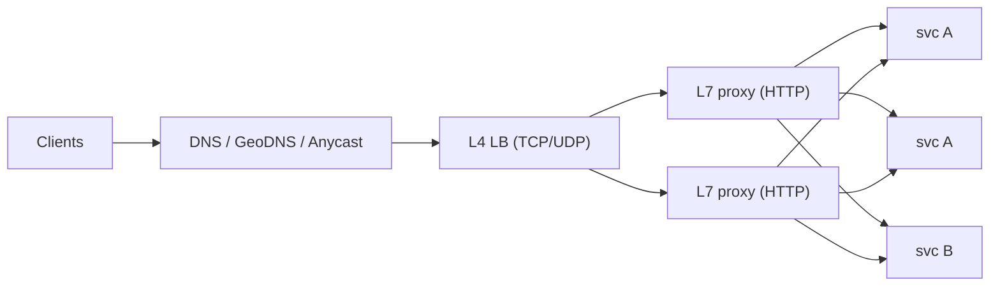

# Scalability Fundamentals

<Note>
**TL;DR**

**Scalability** is the ability to handle more load by adding resources. Scale **up** (bigger machine) until it's too expensive or hits a ceiling, then scale **out** (more machines). Scaling out requires **stateless services** (state moved to databases, caches, or tokens) behind a **load balancer** (L4 or L7) that spreads requests with an algorithm such as round robin, least connections, or consistent hashing. **Autoscaling** adjusts capacity to demand, but the stateful tier (the database) is usually the real bottleneck.
</Note>

## Key terms
| Term | Meaning |
|---|---|
| **Latency** | Time for one request (report p50, p95, p99, not averages) |
| **Throughput** | Requests handled per second |
| **Scalability** | Throughput grows ~linearly as you add resources, without latency blowing up |
| **Elasticity** | Capacity follows load automatically (autoscaling) |
| **Availability** | Fraction of time the system serves correctly |

Performance problem: slow for **one** user. Scalability problem: fast for one user, slow **under load**.

## Vertical vs horizontal
| | Vertical (scale up) | Horizontal (scale out) |
|---|---|---|
| How | Bigger CPU/RAM/disk | More nodes |
| Code changes | None | Services must be stateless, data partitioned |
| Limit | Largest instance available; cost grows super-linearly | Coordination overhead, network |
| Failure | Single point of failure | Redundancy built in |
| Good for | Databases early on, simplicity | Web/API tier, caches, queues |

<Tip>
**Senior default**

Scale the database vertically and add read replicas for as long as possible (a large Postgres instance goes very far). Scale the stateless tier horizontally from day one. See [Clustering and Scaling](/Software%20Engineering/Databases/Database%20Round/Clustering%20and%20Scaling), [Sharding & Partitioning](/Software%20Engineering/Databases/Database%20Round/Sharding%20%26%20Partitioning).
</Tip>

## Stateless services
A service is **stateless** if any instance can handle any request. Move state out:
- Sessions → Redis/Valkey or signed tokens ([JWT vs Cookies](/Software%20Engineering/APIs%20%26%20Auth/JWT%20vs%20Cookies), [Authentication & Token Storage](/Software%20Engineering/Frontend/11%20Security/Authentication%20%26%20Token%20Storage)).
- Uploaded files → object storage ([Blob Storage & File Uploads](/Software%20Engineering/System%20Design/Blob%20Storage%20%26%20File%20Uploads)).
- In-memory caches → shared cache or accept per-node duplication.
- Scheduled jobs → one leader or a queue ([Cron Jobs](/Software%20Engineering/Backend/Cron%20Jobs), [Message Queues & Event Streaming](/Software%20Engineering/System%20Design/Message%20Queues%20%26%20Event%20Streaming)).

Stateless = instances are cattle: kill, replace, autoscale freely. Sticky sessions are a smell (uneven load, lost sessions on node death).

## Load balancing

### L4 vs L7
| | L4 (transport) | L7 (application) |
|---|---|---|
| Sees | IPs, ports, TCP/UDP | HTTP method, path, headers, cookies |
| Can do | Forward connections, very fast, TLS passthrough | Path/host routing, TLS termination, retries, header rewrites, auth, rate limits, compression, canary by header |
| Examples | AWS NLB, Linux IPVS, Maglev | Nginx, Envoy, HAProxy (both modes), AWS ALB |
| Cost | Cheap, millions of conns | More CPU per request |

See [Nginx](/Software%20Engineering/Backend/Nginx), [API Gateways & Reverse Proxies](/Software%20Engineering/Backend/API%20Gateways%20%26%20Reverse%20Proxies).

### Algorithms
| Algorithm | How | Use when |
|---|---|---|
| Round robin | Next server in order | Homogeneous servers, similar requests |
| Weighted round robin | More turns for bigger nodes | Mixed instance sizes, canaries (5% weight) |
| Least connections / least outstanding requests | Pick the least busy | Long or variable requests (WebSockets, uploads) |
| Power of two choices | Pick 2 at random, send to the less loaded | Large fleets; near-optimal with little state |
| IP hash / consistent hashing | Hash a key to a server | Cache affinity, sticky routing ([Consistent Hashing](/Software%20Engineering/System%20Design/Consistent%20Hashing)) |
| Latency-based (EWMA) | Prefer fastest recent responders | Heterogeneous backends (Envoy, Finagle) |

### Health checks
- **Liveness**: is the process alive? **Readiness**: can it take traffic now (DB connected, warmed up)? See [Kubernetes Basics](/Software%20Engineering/DevOps/Kubernetes/Kubernetes%20Basics).
- Active (LB probes `/healthz`) vs passive (outlier detection on 5xx).
- Health checks should not depend on deep downstream calls, or one DB blip ejects every node at once.

### Global load balancing
- **GeoDNS**: return the nearest region's IP. Limited by DNS TTL caching.
- **Anycast**: same IP announced from many locations; BGP routes to the nearest. Used by CDNs and DNS providers ([CDN & Edge Computing](/Software%20Engineering/System%20Design/CDN%20%26%20Edge%20Computing)).

## Autoscaling
- **Reactive**: scale on CPU, RPS, queue depth, or p95 latency (Kubernetes HPA, AWS target tracking).
- **Scheduled / predictive**: pre-scale for known peaks (9am, Black Friday).
- **Scale on the right signal**: CPU for compute-bound, queue lag for workers, concurrency for I/O-bound services.
- Mind the **cold start** (JVM warm-up, cache warm-up, image pulls) and **cooldowns** to avoid flapping.
- Autoscaling the stateless tier can **overwhelm the database**: cap max replicas, use connection pooling ([Connection Pooling](/Software%20Engineering/Databases/Database%20Round/Connection%20Pooling)).

## Worked example: from 1 to 1 million users
1. **One server**: app + DB on one box.
2. **Separate DB**: app server and managed DB; vertical scale.
3. **Load balancer + 2+ app servers**: stateless app, sessions in Redis.
4. **Read replicas + cache**: 90% reads served from cache or replicas ([Caching Strategies](/Software%20Engineering/System%20Design/Caching%20Strategies)).
5. **CDN** for static assets and cacheable API responses.
6. **Async work** via queues (emails, thumbnails).
7. **Shard** the write-heavy data; split services where teams/scaling needs differ ([Microservices Architecture](/Software%20Engineering/DevOps/Microservices%20Architecture)).
8. **Multi-region** for latency and disaster recovery.

## Pitfalls
<Warning>
**Pitfalls**

- Measuring averages. The p99 is what users complain about; with fan-out, one slow backend makes the whole request slow (tail at scale).
- Hidden state: local file uploads, in-memory rate limiters, local cron jobs.
- Retry storms after a failover (see [Distributed Systems Patterns](/Software%20Engineering/System%20Design/Distributed%20Systems%20Patterns)).
- Thundering herd on cold caches after scale-out or deploys.
</Warning>

## Senior perspective
- Know **Amdahl's law** and the **Universal Scalability Law**: contention and coherence costs mean adding nodes eventually *reduces* throughput.
- Prefer **cell-based architecture** (independent copies of the stack, each serving a subset of customers) to limit blast radius.
- **Load shedding** beats falling over: reject low-priority work with 429/503 when saturated.
- Capacity planning: know your per-node throughput from load tests; keep headroom (e.g. run at ≤60% so losing one AZ of three still fits).
- Ask in review: "What is the scaling unit? What's the bottleneck at 10×? What happens during a deploy at peak?"

<Info>
**🆕 2025–2026**

The 2025-10-20 AWS us-east-1 incident showed a second-order effect: after DynamoDB recovered, EC2 instance launches and **Network Load Balancer health checks** kept failing for hours, so autoscaling could not add capacity exactly when it was needed. Design so that existing capacity keeps serving if the control plane (launches, health-check subsystems) is impaired, and avoid health checks that mark everything unhealthy at once. ([AWS post-event summary](https://aws.amazon.com/message/101925/))
</Info>

## Interview questions
<Accordion title="What makes a service horizontally scalable?">
Statelessness (any instance can serve any request), externalized state, idempotent handling so retries are safe, and no shared local resources. Then you add instances behind a load balancer.
</Accordion>

<Accordion title="L4 vs L7 load balancer?">
L4 routes TCP/UDP connections by IP/port; it's fast and protocol-agnostic but can't see HTTP. L7 terminates HTTP(S) and can route by path/header, retry, rate limit, and do canaries, at higher CPU cost. Many setups use both: L4 in front of a fleet of L7 proxies.
</Accordion>

<Accordion title="When would you use least connections over round robin?">
When request durations vary a lot (long polling, WebSockets, uploads, mixed endpoints). Round robin would pile work on a node that's still busy with long requests.
</Accordion>

<Accordion title="Why are sticky sessions a problem?">
Uneven load, lost state when a node dies, harder deploys and autoscaling. Prefer external session stores or tokens. Use affinity only as an optimization (e.g. cache locality) that is safe to lose.
</Accordion>

<Accordion title="Autoscaling is on but latency still spikes at peak. Why?">
Scale-up lag (metrics delay + boot + warm-up), scaling on the wrong metric, the DB or a downstream being the bottleneck, connection limits, or cold caches. Fix with predictive scaling, warm pools, better signals, and load shedding.
</Accordion>

## Related
- [System Design Index](/Software%20Engineering/System%20Design/System%20Design%20Index)
- [System Design Interview Framework](/Software%20Engineering/System%20Design/System%20Design%20Interview%20Framework) · [Consistent Hashing](/Software%20Engineering/System%20Design/Consistent%20Hashing) · [Caching Strategies](/Software%20Engineering/System%20Design/Caching%20Strategies) · [CDN & Edge Computing](/Software%20Engineering/System%20Design/CDN%20%26%20Edge%20Computing) · [Distributed Systems Patterns](/Software%20Engineering/System%20Design/Distributed%20Systems%20Patterns)
- [Nginx](/Software%20Engineering/Backend/Nginx) · [API Gateways & Reverse Proxies](/Software%20Engineering/Backend/API%20Gateways%20%26%20Reverse%20Proxies) · [Kubernetes Basics](/Software%20Engineering/DevOps/Kubernetes/Kubernetes%20Basics) · [Clustering and Scaling](/Software%20Engineering/Databases/Database%20Round/Clustering%20and%20Scaling) · [Connection Pooling](/Software%20Engineering/Databases/Database%20Round/Connection%20Pooling)

## Sources
- Martin Kleppmann, *Designing Data-Intensive Applications*, ch. 1
- [Envoy docs: load balancing](https://www.envoyproxy.io/docs/envoy/latest/intro/arch_overview/upstream/load_balancing/load_balancing)
- [Mitzenmacher: The Power of Two Choices in Randomized Load Balancing](https://www.eecs.harvard.edu/~michaelm/postscripts/mythesis.pdf)
- [Dean & Barroso: The Tail at Scale (CACM 2013)](https://research.google/pubs/the-tail-at-scale/)
- [AWS Well-Architected: Reliability pillar](https://docs.aws.amazon.com/wellarchitected/latest/reliability-pillar/welcome.html)
- [Kubernetes: Horizontal Pod Autoscaling](https://kubernetes.io/docs/tasks/run-application/horizontal-pod-autoscale/)
- [AWS: DynamoDB service disruption summary (Oct 2025)](https://aws.amazon.com/message/101925/)
