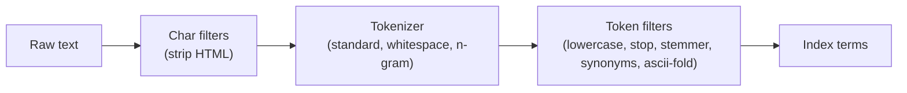
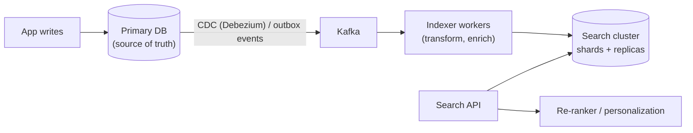

# Search Systems & Inverted Indexes

<Note>
**TL;DR**

Full-text search is built on an **inverted index**: a map from each term to the list of documents (postings) containing it. Text goes through an **analyzer** (tokenize, lowercase, stem, remove stop words) at both index and query time; queries intersect postings lists and **rank** results with **BM25** (term frequency, inverse document frequency, length normalization). Engines like Elasticsearch/OpenSearch, Solr (on Lucene), Meilisearch, Typesense, and Postgres FTS shard the index and are fed asynchronously from the source of truth. Modern search is often **hybrid**: keyword (BM25) plus vector (semantic) retrieval, fused and re-ranked.
</Note>

## Why not `LIKE '%term%'`?
A leading wildcard can't use a B-tree index → full table scan; no relevance ranking, no stemming ("running" vs "run"), no typo tolerance. Search needs a different data structure.

## The inverted index
```text
Docs:
 1: "The quick brown fox"
 2: "Quick brown dogs run"
 3: "The lazy dog"

After analysis (lowercase, stop words removed, stemming dogs→dog):
 term    → postings (docId: positions)
 brown   → 1:[3], 2:[2]
 dog     → 2:[3], 3:[3]
 fox     → 1:[4]
 lazy    → 3:[2]
 quick   → 1:[2], 2:[1]
 run     → 2:[4]
```
- Query `quick dog` (AND) → intersect \{1,2\} ∩ \{2,3\} = **\{2\}**. OR → union, ranked.
- **Positions** enable phrase queries ("brown dog").
- Postings are sorted by doc ID and compressed (delta + variable-byte / frame-of-reference); intersections use skip lists.
- Lucene writes immutable **segments** and merges them in the background; deletes are tombstones until merge. New docs become searchable after a **refresh** (~1 s by default in Elasticsearch): **near real-time**, not immediate.

## Analysis pipeline

The same analyzer (or a compatible one) must run on queries. Language-specific stemming, synonyms (`tv, television`), edge n-grams for **autocomplete**, and fuzzy matching (Levenshtein automata) for typos.

## Ranking: TF-IDF → BM25
- **TF** (term frequency): more occurrences in a doc → more relevant, with diminishing returns.
- **IDF** (inverse document frequency): rare terms matter more ("pgvector" > "the").
- **Length normalization**: a match in a short title beats one in a long essay.
- **BM25** is the standard formula combining these with tunable `k1` (TF saturation) and `b` (length normalization).
- Real ranking adds **business signals**: recency, popularity, personalization, field boosts (`title^3`), then optionally a **learning-to-rank** or cross-encoder **re-ranker** on the top-k.

## Architecture

- The search index is a **derived, eventually consistent** read model (CQRS, see [Distributed Systems Patterns](/Software%20Engineering/System%20Design/Distributed%20Systems%20Patterns)). Keep the ability to **rebuild it from scratch** (reindex into a new index, switch an alias).
- **Sharding**: documents are split across shards (document partitioning); a query fans out to all shards (scatter-gather) and merges top-k. Replicas add read throughput and HA.
- Term-partitioned indexes (each shard holds some terms) are rare: they make multi-term queries cross shards.
- Tail latency grows with fan-out; cap shard count, use routing keys (e.g. tenant ID) to hit one shard.

## Options
| Engine | Notes |
|---|---|
| **PostgreSQL FTS** (`tsvector`, GIN index) | Good enough for many apps; no extra infra; `pg_trgm` for fuzzy/LIKE |
| **Elasticsearch / OpenSearch** | Distributed Lucene; aggregations, logs, BM25 + vectors |
| **Solr** | Lucene-based, mature |
| **Meilisearch / Typesense** | Simple, typo-tolerant, instant search for product catalogs |
| **Vector DBs / pgvector** | Semantic retrieval ([Vector Databases & pgvector](/Software%20Engineering/Databases/Core%20Concepts/Vector%20Databases%20%26%20pgvector)) |

```sql
-- Postgres full-text search
ALTER TABLE articles ADD COLUMN tsv tsvector
  GENERATED ALWAYS AS (to_tsvector('english', coalesce(title,'') || ' ' || body)) STORED;
CREATE INDEX articles_tsv_idx ON articles USING GIN (tsv);
SELECT id, ts_rank(tsv, q) AS rank
FROM articles, websearch_to_tsquery('english', 'quick dog -cat') q
WHERE tsv @@ q ORDER BY rank DESC LIMIT 20;
```

## Hybrid search
Keyword search is precise for names, codes and rare terms; vector search finds meaning ("cheap laptop" ≈ "budget notebook"). Hybrid runs both and fuses results, commonly with **Reciprocal Rank Fusion**: `score(d) = Σ 1 / (k + rank_i(d))`, `k ≈ 60`. Then re-rank the top 50–100 with a cross-encoder. This is also the retrieval step of RAG ([Designing LLM-Powered Systems](/Software%20Engineering/System%20Design/Designing%20LLM-Powered%20Systems)).

## Pitfalls
<Warning>
**Pitfalls**

- Using the search engine as the **primary database** (it can lose acknowledged writes on some failures and isn't transactional).
- Mapping explosions (dynamic fields per user key), too many small shards.
- Deep pagination (`from=10000`) is expensive; use `search_after` cursors.
- Forgetting reindexing strategy when analyzers or mappings change.
- Permission filtering after retrieval (leaks counts, breaks pagination); filter inside the query.
</Warning>

## Senior perspective
- Measure relevance offline (NDCG, MRR, recall@k on a labeled query set) and online (CTR, zero-result rate, reformulation rate).
- Indexing lag SLO: "doc visible in search within 5 s of write, 99% of the time".
- Multi-tenant: index per tenant vs shared index with routing and filters; watch noisy neighbors.
- Capacity: memory for filesystem cache matters more than CPU; keep hot indexes in RAM.

<Info>
**🆕 2025–2026**

Vector retrieval moved into general-purpose stores: **Redis 8** (2025-05-01) added a native vector set type, and **Amazon S3 Vectors** reached GA on **2025-12-02** with up to 2 billion vectors per index, aimed at cheap large-scale RAG and semantic search where ~100 ms+ query latency is acceptable. For low-latency hybrid search, dedicated engines (OpenSearch, Elasticsearch, pgvector) remain the norm. ([Redis](https://redis.io/blog/agplv3/), [AWS What's New](https://aws.amazon.com/about-aws/whats-new/2025/12/amazon-s3-vectors-generally-available/))
</Info>

## Interview questions
<Accordion title="What is an inverted index?">
A mapping from each term to the sorted list of documents (and positions) containing it. Queries look up each term's postings and intersect/union them, which is fast regardless of collection size, unlike scanning every document.
</Accordion>

<Accordion title="Explain BM25 in one minute.">
A relevance score summing, for each query term, its IDF (rarer terms weigh more) times a saturating function of the term's frequency in the document, normalized by document length relative to the average. `k1` controls saturation, `b` length normalization.
</Accordion>

<Accordion title="How do you keep a search index in sync with the database?">
Treat it as a derived view: publish changes via an outbox or CDC to a queue; indexer workers upsert documents idempotently with a version check. Periodically reconcile, and support full reindex with alias swap.
</Accordion>

<Accordion title="Why is search &quot;near real-time&quot;?">
Lucene buffers new documents and makes them visible when a new segment is opened on refresh (default ~1 s). Refreshing on every write would create many tiny segments and kill throughput.
</Accordion>

<Accordion title="How would you design autocomplete?">
Edge n-gram or prefix index (or a trie/FST) over popular queries/titles, ranked by popularity and personalization, cached heavily, with debounced client requests. Frontend side: [Case Study - Autocomplete](/Software%20Engineering/Frontend/15%20System%20Design/Case%20Study%20-%20Autocomplete).
</Accordion>

<Accordion title="Keyword vs vector search?">
Keyword (BM25) matches exact terms; great for names, IDs, rare words, and explainable. Vector search matches meaning via embeddings; handles synonyms and paraphrases but misses exact tokens. Hybrid with rank fusion plus re-ranking usually wins.
</Accordion>

## Related
- [System Design Index](/Software%20Engineering/System%20Design/System%20Design%20Index)
- [Vector Databases & pgvector](/Software%20Engineering/Databases/Core%20Concepts/Vector%20Databases%20%26%20pgvector) · [Designing LLM-Powered Systems](/Software%20Engineering/System%20Design/Designing%20LLM-Powered%20Systems) · [Distributed Systems Patterns](/Software%20Engineering/System%20Design/Distributed%20Systems%20Patterns) · [Message Queues & Event Streaming](/Software%20Engineering/System%20Design/Message%20Queues%20%26%20Event%20Streaming)
- [Database Indexes](/Software%20Engineering/Databases/Database%20Round/Indexes/Database%20Indexes) · [Case Study - Autocomplete](/Software%20Engineering/Frontend/15%20System%20Design/Case%20Study%20-%20Autocomplete) · [Sharding & Partitioning](/Software%20Engineering/Databases/Database%20Round/Sharding%20%26%20Partitioning)

## Sources
- Manning, Raghavan & Schütze, [*Introduction to Information Retrieval*](https://nlp.stanford.edu/IR-book/) (Cambridge, free online)
- [Elastic: Practical BM25](https://www.elastic.co/blog/practical-bm25-part-2-the-bm25-algorithm-and-its-variables)
- [Elasticsearch guide: near real-time search](https://www.elastic.co/guide/en/elasticsearch/reference/current/near-real-time.html)
- [PostgreSQL docs: Full Text Search](https://www.postgresql.org/docs/current/textsearch.html)
- [Cormack et al.: Reciprocal Rank Fusion (SIGIR 2009)](https://plg.uwaterloo.ca/~gvcormac/cormacksigir09-rrf.pdf)
- [AWS: Amazon S3 Vectors GA](https://aws.amazon.com/about-aws/whats-new/2025/12/amazon-s3-vectors-generally-available/)
