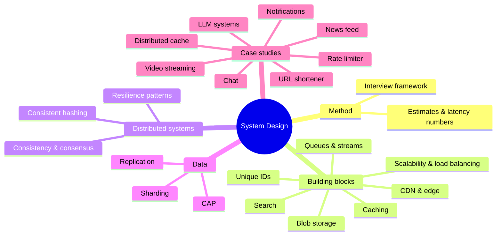

# System Design Index

<Note>
**Start here**

Backend and distributed systems design: how to scale services, cache, queue, replicate, partition, and stay up when things fail, plus worked interview case studies that follow one framework. Each note has examples, a 🆕 2025–2026 box where something changed, and interview questions. For UI-focused design interviews go to [Frontend System Design Index](/Software%20Engineering/Frontend/15%20System%20Design/Frontend%20System%20Design%20Index) and [RADIO Framework](/Software%20Engineering/Frontend/15%20System%20Design/RADIO%20Framework).
</Note>

## 🟢 Beginner: the method and the building blocks
| Note | What you learn |
|---|---|
| [System Design Interview Framework](/Software%20Engineering/System%20Design/System%20Design%20Interview%20Framework) | The 7-step answer, back-of-the-envelope math, latency numbers |
| [Scalability Fundamentals](/Software%20Engineering/System%20Design/Scalability%20Fundamentals) | Vertical vs horizontal, stateless services, L4/L7 load balancing, autoscaling |
| [Caching Strategies](/Software%20Engineering/System%20Design/Caching%20Strategies) | Cache-aside, write-through/behind, eviction, TTL, stampedes, Redis/Valkey |
| [CDN & Edge Computing](/Software%20Engineering/System%20Design/CDN%20%26%20Edge%20Computing) | PoPs, cache keys, invalidation, edge functions |
| [Blob Storage & File Uploads](/Software%20Engineering/System%20Design/Blob%20Storage%20%26%20File%20Uploads) | Object storage, presigned URLs, multipart uploads |

Prerequisites from CS: [How the Internet Works](/Software%20Engineering/CS%20Fundamentals/How%20the%20Internet%20Works) · [Networking - OSI, TCP-IP & Protocols](/Software%20Engineering/CS%20Fundamentals/Networking%20-%20OSI%2C%20TCP-IP%20%26%20Protocols) · see [CS Fundamentals Index](/Software%20Engineering/CS%20Fundamentals/CS%20Fundamentals%20Index).

## 🟡 Intermediate: data and messaging
| Note | What you learn |
|---|---|
| [Message Queues & Event Streaming](/Software%20Engineering/System%20Design/Message%20Queues%20%26%20Event%20Streaming) | Queue vs pub/sub vs log, Kafka/RabbitMQ/SQS, delivery semantics, DLQ, outbox |
| [Unique ID Generation](/Software%20Engineering/System%20Design/Unique%20ID%20Generation) | UUIDv4 vs v7, Snowflake, ULID |
| [Consistent Hashing](/Software%20Engineering/System%20Design/Consistent%20Hashing) | Rings, virtual nodes, hash slots, rendezvous hashing |
| [Search Systems & Inverted Indexes](/Software%20Engineering/System%20Design/Search%20Systems%20%26%20Inverted%20Indexes) | Inverted index, BM25, sync from DB, hybrid search |
| Databases (other folder) | [CAP Theorem](/Software%20Engineering/Databases/Database%20Round/CAP%20Theorem) · [Sharding & Partitioning](/Software%20Engineering/Databases/Database%20Round/Sharding%20%26%20Partitioning) · [Replication & 2PC 3PC](/Software%20Engineering/Databases/Database%20Round/Replication%20%26%202PC%203PC) · [Clustering and Scaling](/Software%20Engineering/Databases/Database%20Round/Clustering%20and%20Scaling) · [Connection Pooling](/Software%20Engineering/Databases/Database%20Round/Connection%20Pooling) · [NoSQL Database Types](/Software%20Engineering/Databases/Core%20Concepts/NoSQL%20Database%20Types) · [Isolation Levels & Read Phenomena](/Software%20Engineering/Databases/Core%20Concepts/Isolation%20Levels%20%26%20Read%20Phenomena) |
| APIs (other folders) | [REST API Design](/Software%20Engineering/APIs%20%26%20Auth/REST%20API%20Design) · [gRPC vs REST](/Software%20Engineering/APIs%20%26%20Auth/gRPC%20vs%20REST) · [GraphQL vs REST](/Software%20Engineering/APIs%20%26%20Auth/GraphQL%20vs%20REST) · [Rate Limiting & Throttling](/Software%20Engineering/APIs%20%26%20Auth/Rate%20Limiting%20%26%20Throttling) · [API Gateways & Reverse Proxies](/Software%20Engineering/Backend/API%20Gateways%20%26%20Reverse%20Proxies) · [Nginx](/Software%20Engineering/Backend/Nginx) |

## 🔴 Senior: distributed systems and architecture
| Note | What you learn |
|---|---|
| [Consistency Models & Consensus](/Software%20Engineering/System%20Design/Consistency%20Models%20%26%20Consensus) | Linearizability → eventual, quorums, Raft/Paxos, vector clocks, CRDTs |
| [Distributed Systems Patterns](/Software%20Engineering/System%20Design/Distributed%20Systems%20Patterns) | Timeouts, retries + jitter, idempotency, circuit breaker, bulkhead, backpressure, saga, CQRS |
| [Designing LLM-Powered Systems](/Software%20Engineering/System%20Design/Designing%20LLM-Powered%20Systems) | RAG, LLM gateways, prompt/semantic caching, evals, guardrails |
| Architecture (other folders) | [Microservices Architecture](/Software%20Engineering/DevOps/Microservices%20Architecture) · [Software Architecture Styles](/Software%20Engineering/Principles/Software%20Architecture%20Styles) · [Observability - Logs, Metrics & Traces](/Software%20Engineering/DevOps/Observability%20-%20Logs%2C%20Metrics%20%26%20Traces) · [Kubernetes Basics](/Software%20Engineering/DevOps/Kubernetes/Kubernetes%20Basics) · [Docker Basics](/Software%20Engineering/DevOps/Docker/Docker%20Basics) |

## 🧩 Case studies (each follows the framework)
| Case study | Key deep dives |
|---|---|
| [Case Study - URL Shortener](/Software%20Engineering/System%20Design/Case%20Studies/Case%20Study%20-%20URL%20Shortener) | Base62 IDs, read-heavy caching, 301 vs 302, async analytics |
| [Case Study - Rate Limiter](/Software%20Engineering/System%20Design/Case%20Studies/Case%20Study%20-%20Rate%20Limiter) | Token bucket in Redis + Lua, fail open vs closed |
| [Case Study - Chat System](/Software%20Engineering/System%20Design/Case%20Studies/Case%20Study%20-%20Chat%20System) | WebSocket gateways, session registry, per-conversation ordering, receipts |
| [Case Study - News Feed Backend](/Software%20Engineering/System%20Design/Case%20Studies/Case%20Study%20-%20News%20Feed%20Backend) | Fan-out on write vs read, hybrid for celebrities, ranking (frontend: [Case Study - News Feed](/Software%20Engineering/Frontend/15%20System%20Design/Case%20Study%20-%20News%20Feed)) |
| [Case Study - Notification System](/Software%20Engineering/System%20Design/Case%20Studies/Case%20Study%20-%20Notification%20System) | Channels, priorities, provider retries, preferences |
| [Case Study - Video Streaming](/Software%20Engineering/System%20Design/Case%20Studies/Case%20Study%20-%20Video%20Streaming) | Transcoding DAG, HLS/DASH, ABR, CDN economics |
| [Case Study - Distributed Cache](/Software%20Engineering/System%20Design/Case%20Studies/Case%20Study%20-%20Distributed%20Cache) | Hash slots, replication, failover, hot keys |
| [Designing LLM-Powered Systems](/Software%20Engineering/System%20Design/Designing%20LLM-Powered%20Systems) | RAG serving at scale |

Frontend case studies: [Case Study - Autocomplete](/Software%20Engineering/Frontend/15%20System%20Design/Case%20Study%20-%20Autocomplete) · [Case Study - Flight Search & Booking](/Software%20Engineering/Frontend/15%20System%20Design/Case%20Study%20-%20Flight%20Search%20%26%20Booking).

<Info>
**🧭 Suggested study path**

1. [How the Internet Works](/Software%20Engineering/CS%20Fundamentals/How%20the%20Internet%20Works) → [Networking - OSI, TCP-IP & Protocols](/Software%20Engineering/CS%20Fundamentals/Networking%20-%20OSI%2C%20TCP-IP%20%26%20Protocols) (CS basics)
2. [System Design Interview Framework](/Software%20Engineering/System%20Design/System%20Design%20Interview%20Framework) → [Scalability Fundamentals](/Software%20Engineering/System%20Design/Scalability%20Fundamentals) → [Caching Strategies](/Software%20Engineering/System%20Design/Caching%20Strategies) → [CDN & Edge Computing](/Software%20Engineering/System%20Design/CDN%20%26%20Edge%20Computing)
3. Data: [CAP Theorem](/Software%20Engineering/Databases/Database%20Round/CAP%20Theorem) → [Sharding & Partitioning](/Software%20Engineering/Databases/Database%20Round/Sharding%20%26%20Partitioning) → [Replication & 2PC 3PC](/Software%20Engineering/Databases/Database%20Round/Replication%20%26%202PC%203PC) → [Consistent Hashing](/Software%20Engineering/System%20Design/Consistent%20Hashing) → [Unique ID Generation](/Software%20Engineering/System%20Design/Unique%20ID%20Generation)
4. [Message Queues & Event Streaming](/Software%20Engineering/System%20Design/Message%20Queues%20%26%20Event%20Streaming) → [Distributed Systems Patterns](/Software%20Engineering/System%20Design/Distributed%20Systems%20Patterns) → [Consistency Models & Consensus](/Software%20Engineering/System%20Design/Consistency%20Models%20%26%20Consensus)
5. Case studies in order: URL shortener → rate limiter → notification → chat → news feed → video → distributed cache
6. [Designing LLM-Powered Systems](/Software%20Engineering/System%20Design/Designing%20LLM-Powered%20Systems) and [Search Systems & Inverted Indexes](/Software%20Engineering/System%20Design/Search%20Systems%20%26%20Inverted%20Indexes)
</Info>

<Info>
**🎯 One week before an interview**

Re-read the framework and latency table, then one case study a day, explaining it out loud in 35 minutes. Finish each with the "trade-offs and failure modes" section and the 🆕 incident lessons from [Distributed Systems Patterns](/Software%20Engineering/System%20Design/Distributed%20Systems%20Patterns).
</Info>

## 🆕 2025–2026 in this area
- **Kafka 4.0** (2025-03-18) removes ZooKeeper (KRaft only); **share groups / Queues for Kafka** production-ready in **Kafka 4.2** (2026-02-17) → [Message Queues & Event Streaming](/Software%20Engineering/System%20Design/Message%20Queues%20%26%20Event%20Streaming), [Consistency Models & Consensus](/Software%20Engineering/System%20Design/Consistency%20Models%20%26%20Consensus)
- **RabbitMQ 4.1** (2025-04-15) and **4.2** (2025-10-28); **SQS fair queues** (2025-07-21) → [Message Queues & Event Streaming](/Software%20Engineering/System%20Design/Message%20Queues%20%26%20Event%20Streaming)
- **Redis 8.0** (2025-05-01) with AGPLv3 option and vector sets; **Valkey 9.0** (2025-10-21) with atomic slot migration → [Caching Strategies](/Software%20Engineering/System%20Design/Caching%20Strategies), [Consistent Hashing](/Software%20Engineering/System%20Design/Consistent%20Hashing), [Case Study - Distributed Cache](/Software%20Engineering/System%20Design/Case%20Studies/Case%20Study%20-%20Distributed%20Cache)
- **PostgreSQL 18** (2025-09-25) ships `uuidv7()` → [Unique ID Generation](/Software%20Engineering/System%20Design/Unique%20ID%20Generation)
- **S3**: 50 TB max object size and **S3 Vectors GA** (2025-12-02) → [Blob Storage & File Uploads](/Software%20Engineering/System%20Design/Blob%20Storage%20%26%20File%20Uploads), [Search Systems & Inverted Indexes](/Software%20Engineering/System%20Design/Search%20Systems%20%26%20Inverted%20Indexes)
- Cloudflare Radar 2025: **21% of requests over HTTP/3**, **52% of human traffic post-quantum encrypted** → [CDN & Edge Computing](/Software%20Engineering/System%20Design/CDN%20%26%20Edge%20Computing)
- Incident lessons: **AWS us-east-1** DynamoDB DNS race (2025-10-20), **Cloudflare** outages (2025-11-18, 2025-12-05) → [Distributed Systems Patterns](/Software%20Engineering/System%20Design/Distributed%20Systems%20Patterns), [System Design Interview Framework](/Software%20Engineering/System%20Design/System%20Design%20Interview%20Framework)
- **OWASP Top 10 for LLM Apps 2025** → [Designing LLM-Powered Systems](/Software%20Engineering/System%20Design/Designing%20LLM-Powered%20Systems)

## Related
- [Software Engineering](/Software%20Engineering/Software%20Engineering), the vault root
- [CS Fundamentals Index](/Software%20Engineering/CS%20Fundamentals/CS%20Fundamentals%20Index) · [Frontend System Design Index](/Software%20Engineering/Frontend/15%20System%20Design/Frontend%20System%20Design%20Index) · [AI & ML Index](/Software%20Engineering/AI%20%26%20ML/AI%20%26%20ML%20Index)
