# System Design Index

> [!tldr] Start here
> Backend and distributed systems design: how to scale services, cache, queue, replicate, partition, and stay up when things fail, plus worked interview case studies that follow one framework. Each note has examples, a 🆕 2025–2026 box where something changed, and interview questions. For UI-focused design interviews go to [[Frontend System Design Index]] and [[RADIO Framework]].

```mermaid
mindmap
  root((System Design))
    Method
      Interview framework
      Estimates & latency numbers
    Building blocks
      Scalability & load balancing
      Caching
      CDN & edge
      Queues & streams
      Blob storage
      Search
      Unique IDs
    Distributed systems
      Consistency & consensus
      Consistent hashing
      Resilience patterns
    Data
      CAP
      Sharding
      Replication
    Case studies
      URL shortener
      Rate limiter
      Chat
      News feed
      Notifications
      Video streaming
      Distributed cache
      LLM systems
```

## 🟢 Beginner: the method and the building blocks
| Note | What you learn |
|---|---|
| [[System Design Interview Framework]] | The 7-step answer, back-of-the-envelope math, latency numbers |
| [[Scalability Fundamentals]] | Vertical vs horizontal, stateless services, L4/L7 load balancing, autoscaling |
| [[Caching Strategies]] | Cache-aside, write-through/behind, eviction, TTL, stampedes, Redis/Valkey |
| [[CDN & Edge Computing]] | PoPs, cache keys, invalidation, edge functions |
| [[Blob Storage & File Uploads]] | Object storage, presigned URLs, multipart uploads |

Prerequisites from CS: [[How the Internet Works]] · [[Networking - OSI, TCP-IP & Protocols]] · see [[CS Fundamentals Index]].

## 🟡 Intermediate: data and messaging
| Note | What you learn |
|---|---|
| [[Message Queues & Event Streaming]] | Queue vs pub/sub vs log, Kafka/RabbitMQ/SQS, delivery semantics, DLQ, outbox |
| [[Unique ID Generation]] | UUIDv4 vs v7, Snowflake, ULID |
| [[Consistent Hashing]] | Rings, virtual nodes, hash slots, rendezvous hashing |
| [[Search Systems & Inverted Indexes]] | Inverted index, BM25, sync from DB, hybrid search |
| Databases (other folder) | [[CAP Theorem]] · [[Sharding & Partitioning]] · [[Replication & 2PC 3PC]] · [[Clustering and Scaling]] · [[Connection Pooling]] · [[NoSQL Database Types]] · [[Isolation Levels & Read Phenomena]] |
| APIs (other folders) | [[REST API Design]] · [[gRPC vs REST]] · [[GraphQL vs REST]] · [[Rate Limiting & Throttling]] · [[API Gateways & Reverse Proxies]] · [[Nginx]] |

## 🔴 Senior: distributed systems and architecture
| Note | What you learn |
|---|---|
| [[Consistency Models & Consensus]] | Linearizability → eventual, quorums, Raft/Paxos, vector clocks, CRDTs |
| [[Distributed Systems Patterns]] | Timeouts, retries + jitter, idempotency, circuit breaker, bulkhead, backpressure, saga, CQRS |
| [[Designing LLM-Powered Systems]] | RAG, LLM gateways, prompt/semantic caching, evals, guardrails |
| Architecture (other folders) | [[Microservices Architecture]] · [[Software Architecture Styles]] · [[Observability - Logs, Metrics & Traces]] · [[Kubernetes Basics]] · [[Docker Basics]] |

## 🧩 Case studies (each follows the framework)
| Case study | Key deep dives |
|---|---|
| [[Case Study - URL Shortener]] | Base62 IDs, read-heavy caching, 301 vs 302, async analytics |
| [[Case Study - Rate Limiter]] | Token bucket in Redis + Lua, fail open vs closed |
| [[Case Study - Chat System]] | WebSocket gateways, session registry, per-conversation ordering, receipts |
| [[Case Study - News Feed Backend]] | Fan-out on write vs read, hybrid for celebrities, ranking (frontend: [[Case Study - News Feed]]) |
| [[Case Study - Notification System]] | Channels, priorities, provider retries, preferences |
| [[Case Study - Video Streaming]] | Transcoding DAG, HLS/DASH, ABR, CDN economics |
| [[Case Study - Distributed Cache]] | Hash slots, replication, failover, hot keys |
| [[Designing LLM-Powered Systems]] | RAG serving at scale |

Frontend case studies: [[Case Study - Autocomplete]] · [[Case Study - Flight Search & Booking]].

> [!example]- 🧭 Suggested study path
> 1. [[How the Internet Works]] → [[Networking - OSI, TCP-IP & Protocols]] (CS basics)
> 2. [[System Design Interview Framework]] → [[Scalability Fundamentals]] → [[Caching Strategies]] → [[CDN & Edge Computing]]
> 3. Data: [[CAP Theorem]] → [[Sharding & Partitioning]] → [[Replication & 2PC 3PC]] → [[Consistent Hashing]] → [[Unique ID Generation]]
> 4. [[Message Queues & Event Streaming]] → [[Distributed Systems Patterns]] → [[Consistency Models & Consensus]]
> 5. Case studies in order: URL shortener → rate limiter → notification → chat → news feed → video → distributed cache
> 6. [[Designing LLM-Powered Systems]] and [[Search Systems & Inverted Indexes]]

> [!example]- 🎯 One week before an interview
> Re-read the framework and latency table, then one case study a day, explaining it out loud in 35 minutes. Finish each with the "trade-offs and failure modes" section and the 🆕 incident lessons from [[Distributed Systems Patterns]].

## 🆕 2025–2026 in this area
- **Kafka 4.0** (2025-03-18) removes ZooKeeper (KRaft only); **share groups / Queues for Kafka** production-ready in **Kafka 4.2** (2026-02-17) → [[Message Queues & Event Streaming]], [[Consistency Models & Consensus]]
- **RabbitMQ 4.1** (2025-04-15) and **4.2** (2025-10-28); **SQS fair queues** (2025-07-21) → [[Message Queues & Event Streaming]]
- **Redis 8.0** (2025-05-01) with AGPLv3 option and vector sets; **Valkey 9.0** (2025-10-21) with atomic slot migration → [[Caching Strategies]], [[Consistent Hashing]], [[Case Study - Distributed Cache]]
- **PostgreSQL 18** (2025-09-25) ships `uuidv7()` → [[Unique ID Generation]]
- **S3**: 50 TB max object size and **S3 Vectors GA** (2025-12-02) → [[Blob Storage & File Uploads]], [[Search Systems & Inverted Indexes]]
- Cloudflare Radar 2025: **21% of requests over HTTP/3**, **52% of human traffic post-quantum encrypted** → [[CDN & Edge Computing]]
- Incident lessons: **AWS us-east-1** DynamoDB DNS race (2025-10-20), **Cloudflare** outages (2025-11-18, 2025-12-05) → [[Distributed Systems Patterns]], [[System Design Interview Framework]]
- **OWASP Top 10 for LLM Apps 2025** → [[Designing LLM-Powered Systems]]

## Related
- [[Software Engineering]], the vault root
- [[CS Fundamentals Index]] · [[Frontend System Design Index]] · [[AI & ML Index]]
